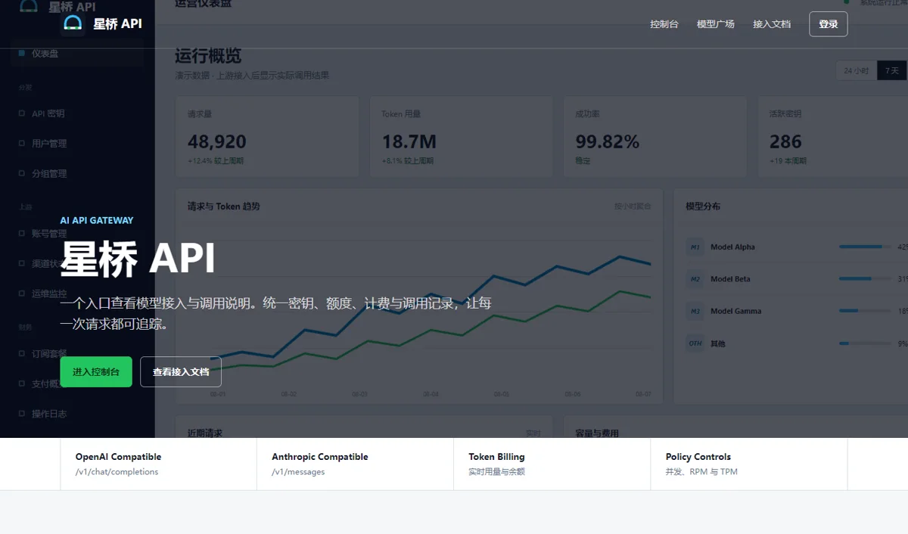
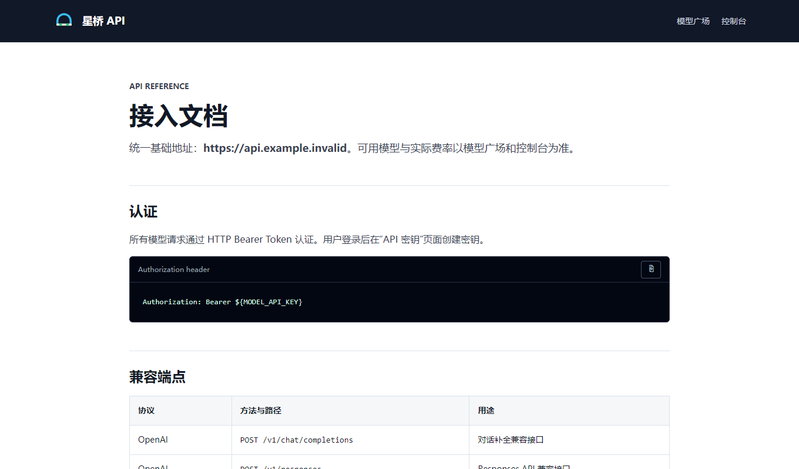

# 星桥 API 官网与接入示例

面向 API 调用方的公开入口，提供模型服务介绍、接入说明、控制台示意和反向代理模板。

## 实际界面巡览



上图由两张本次实际运行画面的截屏轮换组成，不是连续操作录像。

| 星桥首页 | API 接入文档 |
| --- | --- |
|  |  |

## 可以做什么

- 官网、接入文档及条款页
- 独立的演示控制台，可离线查看
- Caddy 示例将静态站和上游服务分开；没有预填真实服务器

## 本地运行

```sh
python -m http.server 8000 --bind 127.0.0.1
```

在浏览器打开 `http://127.0.0.1:8000/`。只监听本机；不执行部署。

## 实测与范围

公开首页、控制台示例和接入文档均在本机打开；未连接上游。

这次发布的是星桥在 Sub2API 0.1.170 上的官网层。后端、账单、支付和渠道账户不在仓库中；旧官网介绍的是整套产品服务，静态预览不会产生真实交易。链接中的 .invalid 为示例域名。

[手机宽度实机截屏（390 px）](showcase/03-mobile.png) · [授权范围](LICENSE) · [来源与署名](NOTICE.md)
